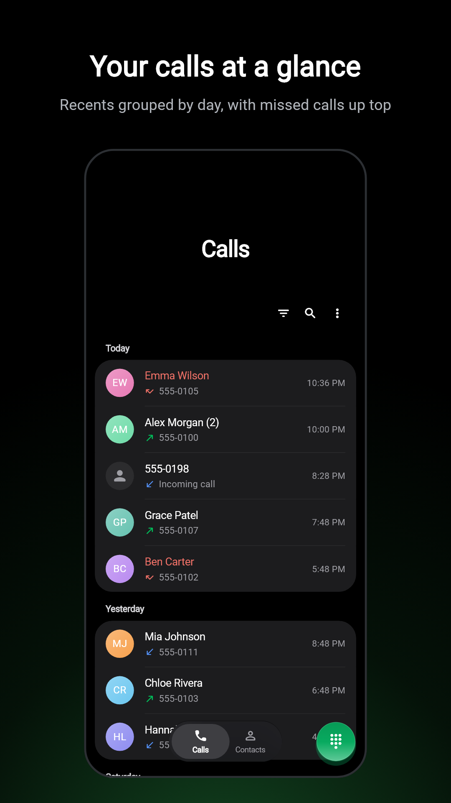
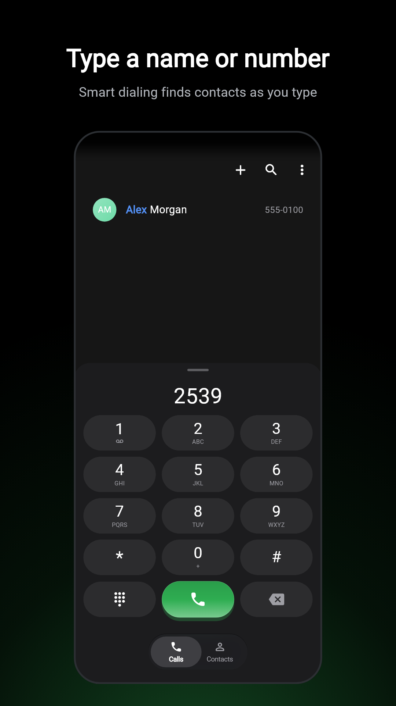
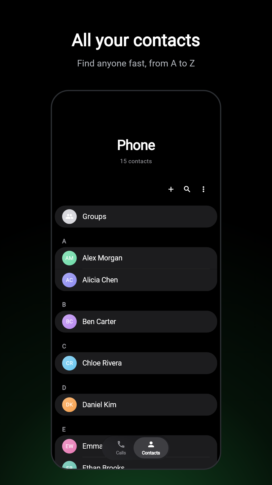
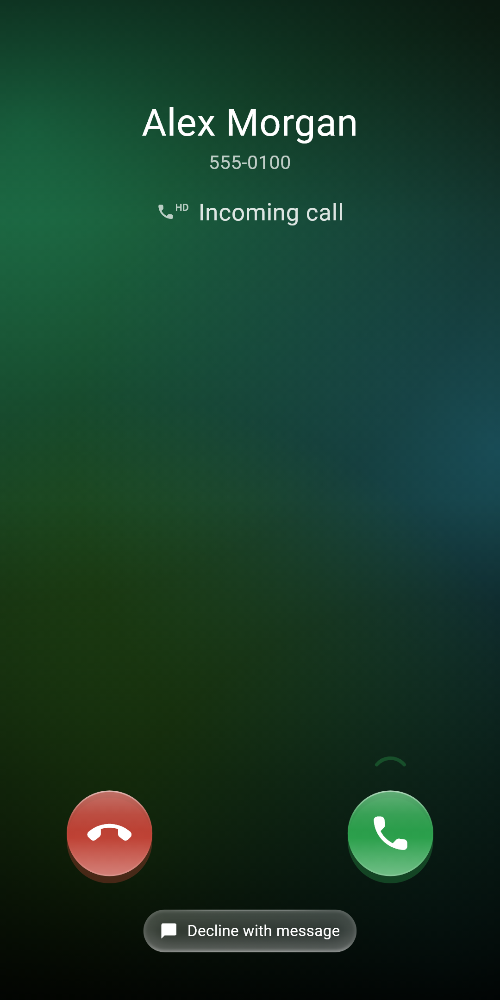
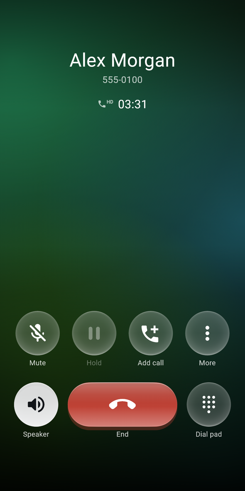

<p align="center">
  
</p>

<h1 align="center">One Dialer</h1>

<p align="center">
  A fast, private phone and contacts app for Android, with a frosted-glass design.<br>
  Built with Flutter on top of Android's own Telecom framework.
</p>

<p align="center">
  <a href="https://syedarhamraza.github.io/one-dialer/">Website</a> ·
  <a href="https://syedarhamraza.github.io/one-dialer/privacy/">Privacy policy</a> ·
  <a href="CONTRIBUTING.md">Contributing</a>
</p>

<p align="center">
  
  
  
  
  
</p>

## Features

- **A real default phone app:** incoming and outgoing calls, hold, swap, merge, mute, speaker and Bluetooth routing, the in-call keypad, and a lock-screen call screen
- **Calls:** grouped call history, a missed-call filter, search and call notes
- **Keypad:** T9 contact search as you type, speed dial, and the pause and wait characters
- **Contacts:** favourites, an A–Z index, search, merging duplicates, vCard import and SIM contacts
- **Dual SIM:** a SIM per contact, "ask every time", and a SIM chooser
- **Blocking:** Android's system block list, plus rules for private and unknown callers
- **Design:** frosted glass and spring motion, with *Reduce visual effects* for slower phones
- **Languages:** English and Italian ([add yours](docs/localization.md))

No ads, no accounts, no servers of its own. Call log and contacts never leave the phone. The only data sent anywhere is crash reports (Firebase Crashlytics), and only from builds made with a Firebase config.

## Permissions

| Permission | Why |
|---|---|
| Phone, call log | Place and manage calls and show call history (required of a default dialer) |
| Contacts | Names, photos, search and editing |
| Notifications, full-screen intent | Ringing and ongoing-call notifications, and the call screen on the lock screen |
| Nearby devices (Bluetooth) | Route call audio to a headset |

## Build from source

Requirements: Flutter stable (the version CI uses is in [`.github/workflows/ci.yml`](.github/workflows/ci.yml)), JDK 17, and an Android 10+ phone.

```bash
flutter pub get
flutter run
```

- **Firebase is optional.** Without `android/app/google-services.json` the app builds with crash reporting off. To use your own Firebase project, put its config file there.
- **Release signing** reads `android/key.properties` (see `android/key.properties.example`). Without it, release builds fall back to debug signing.
- **Calls only work once One Dialer is the default phone app.** Tap "Set" on the first screen.
- **To test incoming calls without a second phone,** debug and profile builds include a fake "Test line". See [CONTRIBUTING.md](CONTRIBUTING.md#testing-calls).

[AGENTS.md](AGENTS.md) is the architecture guide, for people and coding agents alike. It covers how the two Flutter engines, the Kotlin Telecom layer and the UI fit together.

## Contributing

Bug reports, translations and pull requests are welcome. Start with [CONTRIBUTING.md](CONTRIBUTING.md). Report security problems privately, as described in [SECURITY.md](SECURITY.md), not in an issue.

## License

One Dialer is free software under the [GNU General Public License v3.0](LICENSE). The "One Dialer" name, logo and icons are not covered by that license, so forks must use their own name and icons; see [TRADEMARK.md](TRADEMARK.md).
