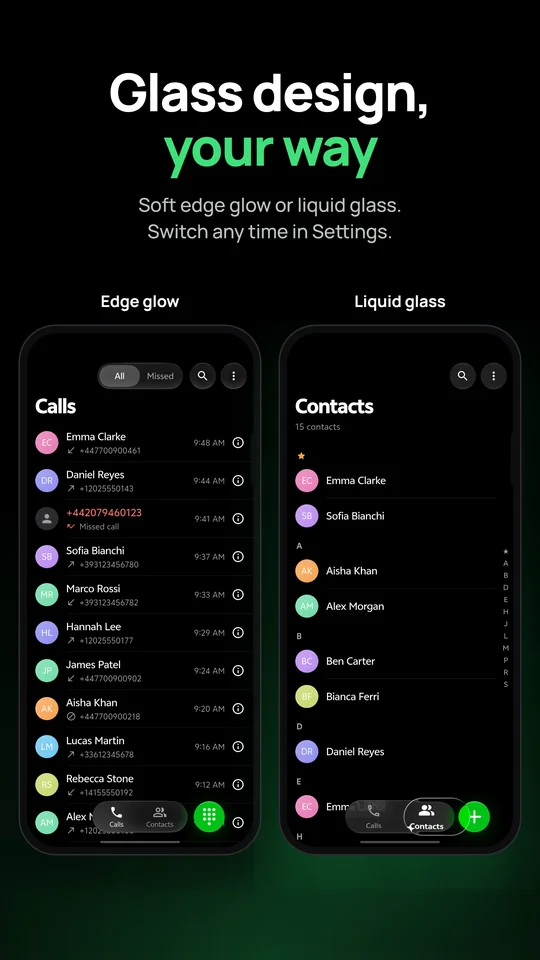
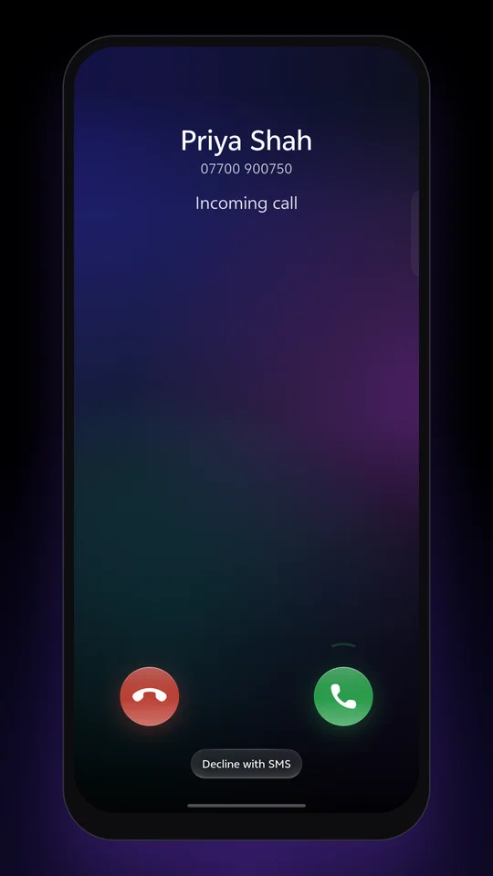
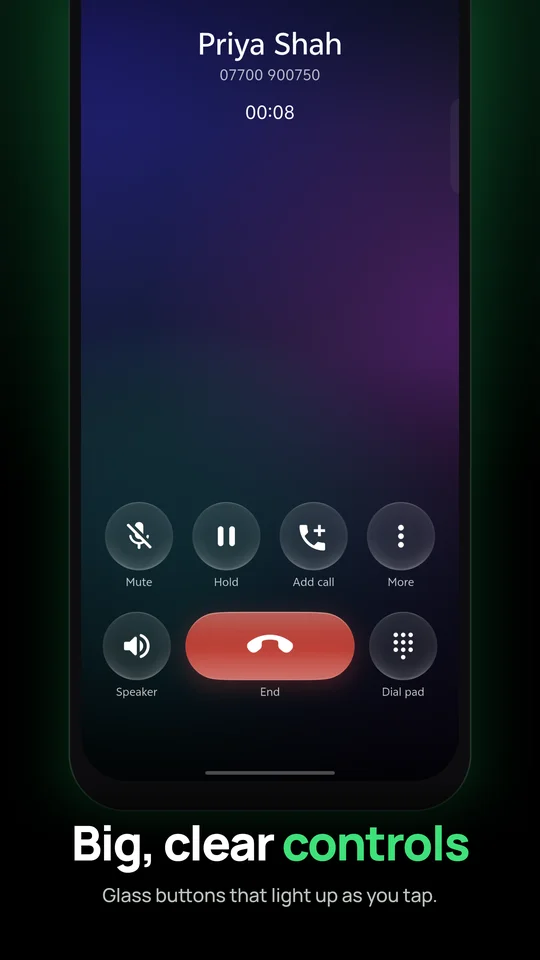
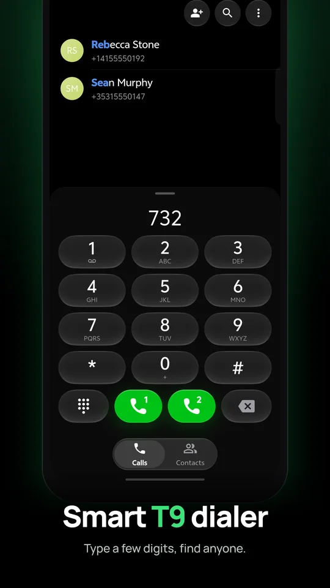
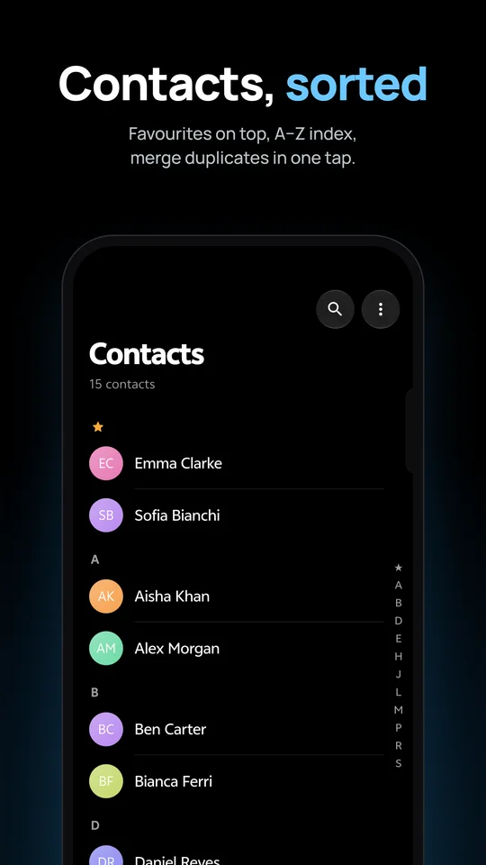
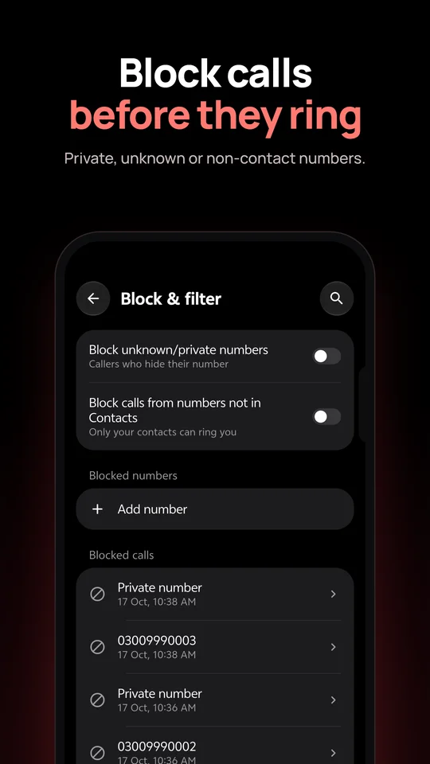
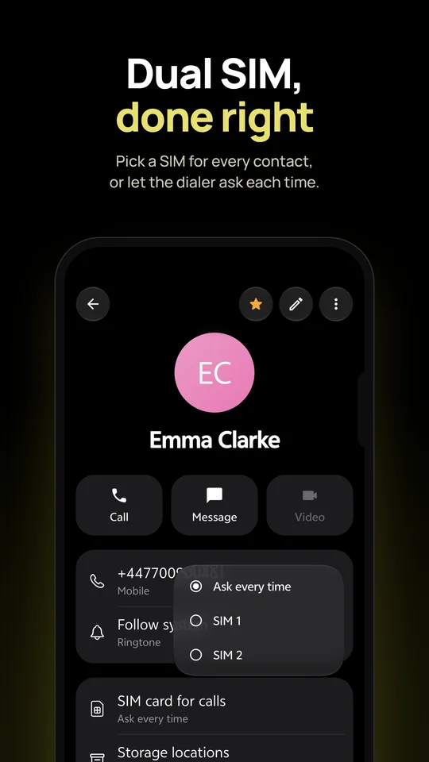
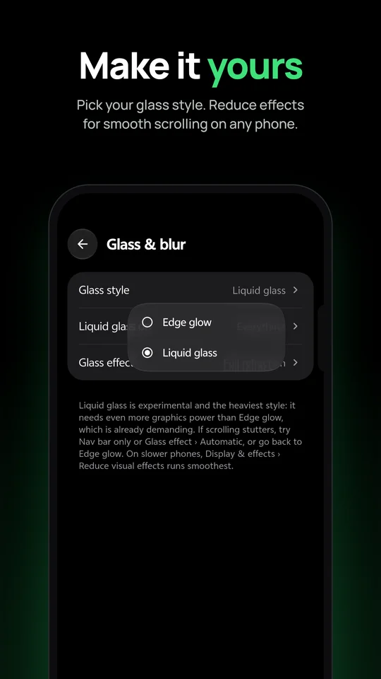

  

<h1 align="center">One Dialer</h1>

  A fast, private phone and contacts app for Android, in a frosted-glass ColorOS-style design. 
  Flutter on top, Android's own Telecom framework underneath. No ads, no accounts, no servers.

  
  
  
  

  <a href="https://syedarhamraza.github.io/one-dialer/">Website</a> ·
  <a href="https://syedarhamraza.github.io/one-dialer/privacy/">Privacy policy</a> ·
  <a href="CONTRIBUTING.md">Contributing</a> ·
  <a href="TRANSLATING.md">Translate</a>

  
  
  
  

  
  
  
  

## Why One Dialer

Most phones ship a dialer you can't change, and most replacements either look dated or want an account. One Dialer is a full **default phone app**: it answers, places and manages every call through Android's own Telecom framework, so calls behave exactly like the system dialer's, and it looks and moves like a modern phone skin. Everything stays on the phone.

## Features

### Calls and the call screen
- Incoming, outgoing and waiting calls: hold, swap, merge into a conference, mute, the in-call keypad, and speaker, earpiece, Bluetooth or wired headset routing.
- A frosted call screen with spring motion. The backdrop is tinted by the caller, or uses a photo of your choice for everyone or per contact.
- Answer with two buttons or one swipe ball, and decline with a quick SMS reply (edit the list in Settings).
- Works on the lock screen. While unlocked, a call rings as a banner or opens the full call screen (your choice).
- Answer and end-call options: vibrate on connect and hang-up, speaker by default, auto-answer with a headset, and announce the caller's name.
- Call notes, written during or after a call and shown in your call history.
- **vivo Origin Island** shows a ringing and in-call card, and Android 16 phones can show the call as a Live Update.

### Calls tab and keypad
- Grouped call history, a missed-calls filter, search, and per-call details with notes.
- Delete a single call, a selection, or a number's whole history.
- A T9 keypad that finds contacts as you type, speed dial on keys 2–9, and hold-to-type `+`, pause and wait.
- Paste a number, place the cursor anywhere, and add it to a new or existing contact.

### Contacts
- Favourites, an A–Z index, search, and a second **Contacts** launcher icon, like on vivo and ColorOS.
- Merge duplicates, import vCards, read SIM contacts, and see where each contact is stored.
- Choose which accounts to show, sorting, name order and the default save location.
- A default SIM per contact, plus "ask every time" for dual SIM.

### Blocking
- Android's system block list, so blocked numbers are rejected before they ring.
- Rules for private and unknown callers, run by Android's call screening.

### Make it yours
- Light, dark or system theme. **Glass & blur** lets you choose between Edge glow and Liquid glass.
- **Reduce visual effects** (Full, Reduced or Off) for the app and, separately, for the call screen. It defaults to what your phone's chip handles smoothly.
- Glossy or Classic app icons.
- English and Italian ([add your language](TRANSLATING.md)).

### Call recording (optional)
Recording lives in a separate, sideloaded companion app, **One Recorder**. Install it from [GitHub Releases](https://github.com/syedarhamraza/one-dialer/releases) and recording controls appear in the call screen and Settings. Without it, One Dialer never touches the microphone. Recording laws differ by country, so check yours first.

## Install

1. Join the closed test on [Google Play](https://play.google.com/apps/testing/com.syedarhamraza.onedialer) and install One Dialer.
2. Open it and tap **Set** to make it your default phone app. Calls only route through One Dialer once it's the default.
3. Optional: install **One Recorder** from [GitHub Releases](https://github.com/syedarhamraza/one-dialer/releases) for call recording.

It needs Android 10 or newer.

## Privacy

No ads, no accounts and no servers of its own. Your call log, contacts and notes never leave the phone. The only data sent anywhere is crash and lag diagnostics (Firebase Crashlytics), which contain no numbers, names or call history. Details: [privacy policy](https://syedarhamraza.github.io/one-dialer/privacy/).

## Permissions

| Permission | Why |
|---|---|
| Phone, call log | Place and manage calls and show call history (required of a default dialer) |
| Contacts | Names, photos, search and editing |
| Notifications, full-screen intent | Ringing and ongoing-call notifications, and the call screen on the lock screen |
| Nearby devices (Bluetooth) | Route call audio to a headset |
| Call screening role (only if you turn on a blocking rule) | Reject private or unknown callers |

## Contributing

Bug reports, translations and pull requests are welcome.

- **Translate the app:** follow [TRANSLATING.md](TRANSLATING.md). No coding needed.
- **Change the code:** start with [CONTRIBUTING.md](CONTRIBUTING.md). [AGENTS.md](AGENTS.md) is the architecture guide, for people and coding agents alike.
- **Found a security problem?** Report it privately as described in [SECURITY.md](SECURITY.md), not in an issue.

## Contributors

Thanks to everyone who has helped build One Dialer.

## License

One Dialer is free software under the [GNU General Public License v3.0](LICENSE). The "One Dialer" name, logo and icons are not covered by that license, so forks must use their own name and icons; see [TRADEMARK.md](TRADEMARK.md).
